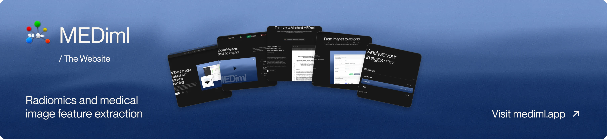

  

<strong>The official website for MEDiml.</strong>

  
  
  

  &nbsp;<a href="https://mediml.app/">Live Website</a>

## About

This repository hosts the official website for [MEDiml-app](https://github.com/MEDomicsLab/MEDiml-app), a desktop application for radiomics analysis, and [MEDiml-pkg](https://github.com/MEDomicsLab/MEDiml-pkg), a Python package for radiomics analysis and medical image feature extraction.
